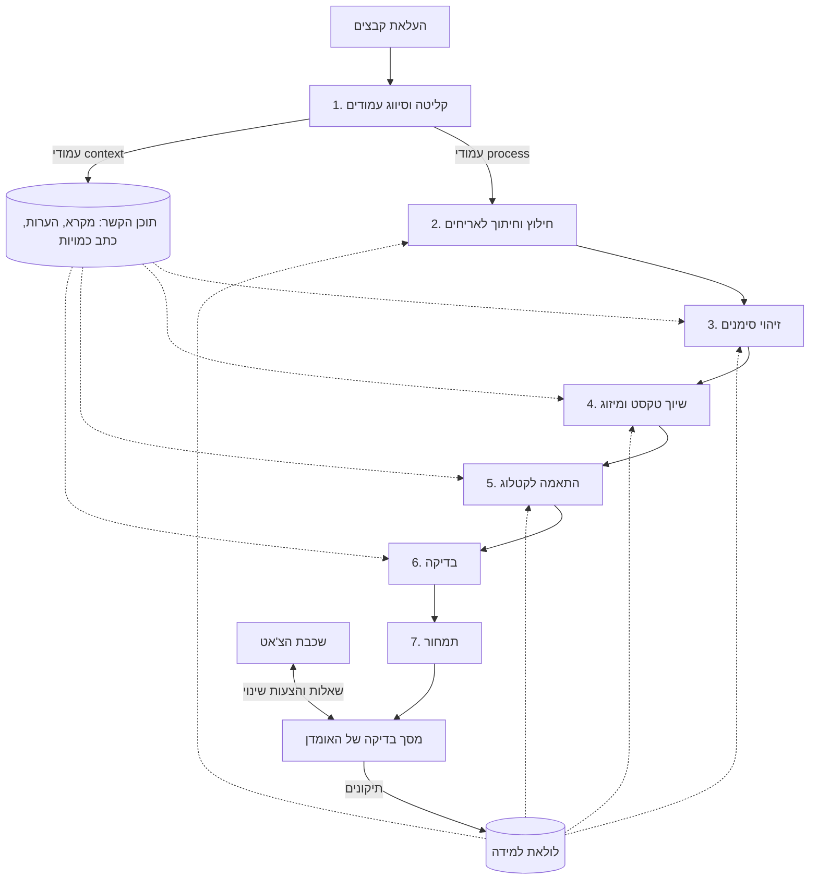

# קונבורו: ארכיטקטורת צינור הפענוח וההצעות

| | |
| --- | --- |
| **מוצר** | קונבורו, מערכת הצעות מחיר למפעלי לוחות חשמל |
| **מסמך** | ארכיטקטורה כללית ומפתח למפרטי השלבים |
| **גרסה** | 0.1 (טיוטה) |
| **תאריך** | 30.10.2026 |

---

## 1. תקציר

קונבורו מקבלת שרטוט של לוח חשמל ומחזירה הצעת מחיר מוכנה לבדיקה. הצינור מחולק לשבעה שלבים. לכל שלב יש קלט ופלט מוגדרים, מדדים משלו, ומפרט נפרד.

**ההחלטה המרכזית:** מוצר ורטיקלי משלנו שמשתמש במודלים קיימים דרך API. לא מאמנים מודל שפה, ולא בונים את המוצר על צ'אט כללי עם הוראות מותאמות. **הנכס שלנו הוא הנתונים:** קטלוג מאסטר, ספריית סימנים, מיפוי בלוקים, זיכרון התאמות, וכל תיקון שמשתמש עושה.

**היעד העסקי:** הצעה מוכנה לבדיקה תוך 15 דקות, במקום חצי יום עבודה של אומדן.

**המדד המרכזי:** אחוז השורות בהצעה שהמשתמש אישר בלי לתקן. היום כ-70%. יעד ל-12 חודשים: 95% בשרטוטים וקטוריים.

---

## 2. מפת המסמכים

| קובץ | שלב | תוכן | סטטוס |
| --- | --- | --- | --- |
| [00-architecture.md](00-architecture.md) | — | המסמך הזה: עקרונות, חוזים בין שלבים, מוסכמות משותפות | טיוטה 0.1 |
| [01-intake-page-classification.md](01-intake-page-classification.md) | 1 | קליטה, נרמול, סיווג עמודים, לוחות, תוכן הקשר | טיוטה 0.1 |
| [02-extraction-tiling.md](02-extraction-tiling.md) | 2 | רינדור, חילוץ וקטורי, בלוקי CAD, OCR, גרף חיבורים, אריחים | טיוטה 0.1 |
| [03-symbol-detection.md](03-symbol-detection.md) | 3 | גלאי משפחות, סיווג עדין לפי דמיון, סוכן הכרעה, אריח בעלים | טיוטה 0.1 |
| [04-text-association-merge.md](04-text-association-merge.md) | 4 | פענוח כיתובים, שיוך טקסט לסימן, סוכן אריח, מיזוג לרכיבים | טיוטה 0.1 |
| [05-catalog-matching.md](05-catalog-matching.md) | 5 | מותג, השלמת תכונות, שאילתת מועמדים, זיכרון התאמות | טיוטה 0.1 |
| [06-validation.md](06-validation.md) | 6 | מנוע כללים, השוואה לכתב כמויות, סוכן בודק | טיוטה 0.1 |
| [07-pricing.md](07-pricing.md) | 7 | עלות, חוקי רווח, פריטים נלווים, צבע שורה, גרסאות הצעה | טיוטה 0.1 |
| [08-chat-layer.md](08-chat-layer.md) | ממשק | שכבת הצ'אט: כלים, הצעות שינוי, הפניות לסכומים, הרשאות | טיוטה 0.1 |
| [09-review-screen.md](09-review-screen.md) | ממשק | מסך הבדיקה: פריסה, פעולות, עמודים, אירועי תיקון, בדיקת שימושיות | טיוטה 0.1 |
| [10-onboarding.md](10-onboarding.md) | מפעל חדש | אונבורדינג דרך השימוש: שתי שאלות, מחירון שנבנה מההצעות, האצות, כיסוי | טיוטה 0.1 |
| [11-quote-audit.md](11-quote-audit.md) | מוצר ראשון | בדיקת הצעה קיימת: השוואה בין שרטוט להצעה ידנית, הבדלים וכסף בסיכון | טיוטה 0.1 |
| [12-tech-stack.md](12-tech-stack.md) | תשתית | סטאק הטכנולוגיות לגרסה 1.0: AWS, Claude דרך Bedrock, OCR, רישיונות | טיוטה 0.1 |
| [13-feature-flags.md](13-feature-flags.md) | תשתית | דגלי תכונות, ותכונות שנוספו לגרסה 1.0: הורדה, הצעה בצ'אט וקול, בית כשיחה, סימון מה לא פוענח | טיוטה 0.1 |
| [prototype/konboro-app.html](../prototype/konboro-app.html) | ממשק | אב טיפוס מלא של גרסה 1.0, רפרנס לפיתוח: כל המסכים, על נתוני סט הבדיקה | טיוטה 0.1 |
| [prototype/review-screen.html](../prototype/review-screen.html) | ממשק | אב טיפוס לחיץ של מסך הבדיקה, עם נתוני דוגמה | טיוטה |

### מסמכים שעוד חסרים

| נושא | למה הוא נדרש |
| --- | --- |
| מודל הנתונים (סכמת DB) | טבלאות, אינדקסים והפרדת דיירים |
| שירות הלמידה | איסוף תיקונים, אינדקס דמיון, אימון הגלאי, מעבר לשכבה הגלובלית |
| תשתית המדידה | סט הבדיקה, סט השגיאות המוזרקות, הרצה אוטומטית לכל שינוי |

---

## 3. עקרונות ארכיטקטורה

אלה העקרונות שכל המפרטים נשענים עליהם. כשיש התלבטות בהחלטה טכנית, הם מכריעים.

| # | עיקרון | איך הוא בא לידי ביטוי |
| --- | --- | --- |
| 1 | **צינור של שלבים, לא מודל אחד** | כל שלב נמדד ומוחלף בנפרד. הקורדינטור הוא קוד, לא LLM |
| 2 | **דטרמיניסטי איפה שאפשר** | קוד ומודלים ייעודיים קודם. LLM רק במקרים העמומים, ותמיד עם בחירה מתוך רשימה סגורה |
| 3 | **כל ערך חייב ראיה** | ערכים מצביעים על המקור שלהם בשרטוט. ערך לא כתוב הוא `null` |
| 4 | **ביטחון לכל פריט** | כל זיהוי, תכונה, התאמה ומחיר נושאים ביטחון, וכולם מתנקזים לצבע השורה |
| 5 | **הטעויות לא סימטריות** | שורה חסרה גרועה משורה מיותרת. כל השלבים מכוונים לא לפספס |
| 6 | **אדם בלולאה** | המערכת מציעה, האומדן מאשר. היעד הוא לקצר את הבדיקה, לא לבטל אותה |
| 7 | **כל תיקון הוא נתון** | תיקון של משתמש נשמר ומשפר את המערכת, ברוב המקרים כבר מהשרטוט הבא |
| 8 | **ידע משותף, נתונים פרטיים** | סימנים וקטלוג משותפים לכל המפעלים. מחירים, לקוחות ושרטוטים פרטיים לכל מפעל |
| 9 | **מחירים לא יוצאים** | מחירי עלות ושולי רווח לא נשלחים לאף מודל, ולא מופיעים במסמך ללקוח |

---

## 4. הצינור

### 4.1 תרשים



### 4.2 השלבים במבט אחד

| שלב | מי עושה את העבודה | קלט עיקרי | פלט עיקרי | השאלה שהשלב עונה עליה |
| --- | --- | --- | --- | --- |
| [1](01-intake-page-classification.md) | קוד + LLM קטן | קבצים | עמודים מסווגים, לוחות, תוכן הקשר | מה יש בקבצים, ומה מהם לפענח? |
| [2](02-extraction-tiling.md) | קוד + OCR | עמודי `process` | טקסט עם מיקום, בלוקי CAD, אריחים | מה כתוב בעמוד, ואיפה בדיוק? |
| [3](03-symbol-detection.md) | גלאי + embedding + LLM לעמומים | אריחים | זיהויים עם סוג ומיקום | איפה יש סימן, ומה הוא? |
| [4](04-text-association-merge.md) | קוד + LLM לאריחים עמומים | זיהויים + טקסט | רכיבים עם תכונות וכמות | איזה מא"ז זה? 16A? 3P? כמה יש? |
| [5](05-catalog-matching.md) | קוד + LLM לעמומים | רכיבים | מק"ט לכל רכיב | איזה מוצר המפעל יקנה? |
| [6](06-validation.md) | כללים + LLM ללוח | הכל | ממצאים | מה לא הגיוני ביחד? |
| [7](07-pricing.md) | קוד בלבד | מק"טים + ממצאים | הצעה מתומחרת עם צבעים | כמה זה עולה, וכמה בטוחים בכל שורה? |

### 4.3 ריצה

- **הקורדינטור הוא עבודת רקע בפייתון**, אחת לכל שרטוט. הוא מפעיל את השלבים לפי הסדר, ובתוך כל שלב מריץ עמודים או אריחים במקביל.
- **מגבלת מקביליות לכל מפעל**, כדי שמפעל אחד עם שרטוט ענק לא יחסום אחרים.
- **כשל חלקי לא מפיל את ההצעה.** אריח שנכשל מייצר שורות צהובות או אדומות. ההצעה ממשיכה.
- **התקדמות גלויה:** הממשק מציג באיזה שלב השרטוט נמצא.
- **עצירה מוקדמת:** שלב 1 עוצר תוך שניות על קובץ לא קריא, ושלב 1 יכול לבקש אישור סיווג לפני שממשיכים.

### 4.4 סוגי קלט

בקשות להצעת מחיר מגיעות בשלוש צורות, ולפעמים בשילוב ([01 §4.4](01-intake-page-classification.md)):

| סוג | מה מגיע | מסלול |
| --- | --- | --- |
| שרטוט ייצור של מפעל לוחות | תגים, דגמים מפורשים, עמודי נתונים ותבנית | כל שבעת השלבים. ההתאמה לקטלוג כמעט דטרמיניסטית, והאתגר הוא איחוד לפי תגים והסקת ערכים חסרים |
| תוכנית של מתכנן | זרם ועקומה, לרוב בלי דגם ובלי תגים | כל שבעת השלבים. האתגר הוא קריאת הטקסט וההתאמה לקטלוג |
| כתב כמויות בלבד | אקסל, PDF, תמונה, צילום או כתב יד | שלב 1, קריאת הטבלה במקום שלבים 2 עד 4 ([01 §5.8](01-intake-page-classification.md)), ואז 5 עד 7 |

כל סוג נמדד בנפרד בסט הבדיקה.

**פורמטים בגרסה הראשונה:** PDF (וקטורי או סרוק), תמונות, אקסל ו-CSV. **DWG ו-DXF נדחים לגרסה 2.0.** המשתמש מתבקש לייצא PDF. החוזים כבר כוללים את שדות ה-CAD, כך שהתוספת לא תשנה אותם ([01 §4.2](01-intake-page-classification.md)).

**מגבלות:** קובץ עד 20MB, מספר עמודים לקובץ לפי החבילה, ומכסת הצעות חודשית לפי החבילה ([01 §4.3–4.5](01-intake-page-classification.md)).

---

## 5. חוזים בין השלבים

כל שלב מקבל רק את הפלט המוגדר של השלבים הקודמים. **שינוי במבנה פלט מחייב עדכון של המפרט שמגדיר אותו ושל כל המפרטים שצורכים אותו.**

### 5.1 הזרימה הראשית

| מ- | אל | מה עובר | הגדרה |
| --- | --- | --- | --- |
| 1 | 2 | עמודים עם `route` = `process`: `geometry_source`, `text_source`, `rotation_applied`, `size_pt`, `panels[]`, `quality` | [01 §6](01-intake-page-classification.md) |
| 2 | 3 | `tiles[]`, `pre_detections[]`, `cad_blocks[]`, `text_spans[]` עם `tags` | [02 §6](02-extraction-tiling.md) |
| 3 | 4 | `detections[]` עם `owner_tile_id`, `family`, `symbol_class`, `confidence`; `orphan_texts[]` | [03 §6](03-symbol-detection.md) |
| 4 | 5 | `components[]` עם תכונות, מקור לכל תכונה, כמות, `brand_hint`, `explicit_texts` | [04 §6.3](04-text-association-merge.md) |
| 5 | 6 | `matches[]` עם `chosen_sku`, `catalog_item`, `status`, `defaulted_attributes`, `substitution` | [05 §6](05-catalog-matching.md) |
| 6 | 7 | `issues[]`, `row_status_caps[]` | [06 §6](06-validation.md) |
| 7 | ממשק | גרסת הצעה: לוחות, שורות, סיכומים, צבעים, עקבות מחיר | [07 §6](07-pricing.md) |

### 5.2 זרימות צד

| מקור | צרכנים | מה עובר |
| --- | --- | --- |
| 1: `context_artifacts` מסוג `legend` | 3, 4 | הגדרות הסימנים של המתכנן, כדוגמאות לשרטוט הזה בלבד |
| 1: `general_notes` | 5, 6 | הוראות כמו "כל המא"זים 10kA, תוצרת שניידר" |
| 1: `bom_table` | 5, 6 | מק"טים מפורשים, והשוואה לכתב הכמויות של המתכנן |
| 1: `title_block.designer` | 2, 3, 4 | טעינת מיפוי בלוקים, וריאנטים של סימנים ודוגמאות למתכנן הזה |
| 2: `wire_graph` | 6 | היררכיה חשמלית לבדיקות קואורדינציה |
| 4: `context_elements` | 6, 7 | פסי צבירה ורכיבים מבניים, לבדיקות ולפריטים נלווים |
| 4: `missing[]` | 7 | שורות אדומות לסימנים שכנראה פוספסו |

### 5.3 מי אחראי על מה

כדי שלכל ערך יהיה מקור אחד ברור, התחומים מופרדים:

| נושא | שלב אחראי | שלבים אחרים |
| --- | --- | --- |
| האם יש סימן ומה הוא | 3 | 4 יכול לדווח על פספוס, לא לשנות סוג |
| הסרת כפילויות בין אריחים | 3 (אריח בעלים) | — |
| תכונות שכתובות ליד הרכיב | 4 | — |
| איחוד מכשיר שמופיע בכמה עמודים (לפי תג) | 4 | 3 מקשר כל סימן לתג שלו |
| תכונות שלא כתובות ומוסקות מהמעגל (כמו זרם מגען) | 5 | 4 מעביר את הקשר המעגל |
| תכונות מהערות כלליות ומברירות מחדל | 5 | 4 לא משלים ערכים |
| מותג ומק"ט | 5 | 7 לא מחליף מק"ט |
| קשרים בין רכיבים | 6 | — |
| מחיר ופריטים נלווים | 7 | — |
| **צבע השורה הסופי** | **7** | כל השלבים תורמים ביטחון וסטטוס |

---

## 6. מוסכמות משותפות

### 6.1 שרשרת המזהים

כל שורה בהצעה ניתנת למעקב חזרה עד הנקודה בשרטוט. זה מה שמאפשר את המסך המפוצל: לחיצה על שורה מסמנת את הרכיבים בשרטוט.

```
line_id  →  component_id  →  instance_id[]  →  det_id  →  tile_id  →  page_id  →  file_id  →  drawing_id
(שלב 7)     (שלב 4)          (שלב 4)            (שלב 3)    (שלב 2)     (שלב 1)      (שלב 1)      (שלב 1)
```

| מזהה | נוצר בשלב | קידומת |
| --- | --- | --- |
| `drawing_id` | 1 | `drw_` |
| `file_id` | 1 | `fil_` |
| `page_id` | 1 | `pg_` |
| `panel_id` | 1 | `pnl_` |
| `span_id` | 2 | `ts_` |
| `block_id` | 2 | `blk_` |
| `tile_id` | 2 | `tl_` |
| `det_id` | 3 | `det_` |
| `instance_id` | 4 | `ins_` |
| `component_id` | 4 | `cmp_` |
| `issue_id` | 6 | `iss_` |
| `quote_id`, `line_id` | 7 | `quo_`, `ln_` |
| `trace_id` | כל השלבים | `trc_` |

### 6.2 מערכת קואורדינטות

**הגדרה אחת לכל הצינור** (מוגדרת ב-[01 §6.4](01-intake-page-classification.md)):
- יחידות: נקודות PDF (1/72 אינץ').
- ראשית: הפינה השמאלית העליונה של העמוד, **אחרי** תיקון הסיבוב.
- פורמט: `[x0, y0, x1, y1]`.
- המרה מפיקסלים: `pt = px / px_per_pt`, כש-`px_per_pt = dpi / 72` ([02 §2.1](02-extraction-tiling.md)).

מודל הזיהוי וסוכן האריח עובדים בפיקסלים של האריח. ההמרה לנקודות קורית מיד כשהפלט שלהם חוזר.

### 6.3 ביטחון וצבע

| שלב | מה נמדד | איפה מוגדר |
| --- | --- | --- |
| 1 | ביטחון סיווג העמוד | [01 §5.4](01-intake-page-classification.md) |
| 2 | ביטחון כל מקטע טקסט (1.0 לווקטורי) | [02 §6.2](02-extraction-tiling.md) |
| 3 | ביטחון זיהוי וסיווג | [03 §6.3](03-symbol-detection.md) |
| 4 | ביטחון לכל תכונה ולכל מופע | [04 §6.4](04-text-association-merge.md) |
| 5 | ביטחון ההתאמה, עם קנסות על ברירות מחדל והחלפת מותג | [05 §6.3](05-catalog-matching.md) |
| 6 | חומרת ממצאים ← תקרה לצבע | [06 §6.5](06-validation.md) |
| 7 | **הצבע הסופי**: הגרוע מבין כל המקורות | [07 §7.5](07-pricing.md) |

**ספים אחידים בכל השלבים:**

| ביטחון | צבע |
| --- | --- |
| ≥ 0.85 | ירוק |
| 0.5 עד 0.85 | צהוב |
| < 0.5 | אדום |

**כיול:** כל הספים והנוסחאות הם ערכים התחלתיים. מכיילים אותם על סט הבדיקה, כך ש**שורה ירוקה תהיה שגויה ב-1% מהמקרים לכל היותר**. זה המדד שקובע אם המשתמשים יסמכו על הירוק ויפסיקו לבדוק אותו, וזה החיסכון האמיתי בזמן.

### 6.4 סכמות תכונות

סכמת התכונות לכל משפחה היא **הגדרה אחת שמשותפת לשלבים 4, 5 ו-6**:
- שלב 4 יודע אילו תכונות לקרוא.
- שלב 5 יודע איך להשוות (`exact`, `gte`, `prefer`) ומתי מותרת ברירת מחדל.
- שלב 6 משתמש בתכונות הסופיות לבדיקות.

ההגדרה ב-[05 §4.4](05-catalog-matching.md). **זרם וקטבים לעולם לא מקבלים ברירת מחדל.**

### 6.5 טיפוסים

- סכומי כסף: Decimal, נשמרים ומועברים כמחרוזת. אף פעם לא float.
- תאריכים: ISO 8601.
- כל טקסט שמוצג למשתמש: בעברית, בשדה ייעודי (`message`, `reason`, `explanation`).
- כל ערך לא ידוע: `null`, ולא מחרוזת ריקה או 0.

---

## 7. שימוש במודלים

### 7.1 מפת המודלים

| שלב | מפתח ב-`config.py` | סוג | מה המודל מקבל | מה הוא לא מקבל |
| --- | --- | --- | --- | --- |
| 1 | `page_classification` | LLM קטן, ראייה | תמונה מוקטנת + קטע טקסט | מחירים, לקוח |
| 1 | `context_extraction` | LLM, ראייה | עמוד הקשר אחד: נתונים טכניים, חזית, מקרא | מחירים, לקוח |
| 1, 11 | `table_transcription` | LLM, ראייה | עמוד של כתב כמויות או הצעה קיימת (תמונה, כתב יד), ומיפוי עמודות באקסל | **פרטי קשר של הלקוח** לא נשמרים מהתשובה |
| 2 | — | OCR | עמוד מרונדר | — |
| 3 | — | גלאי משפחות (שלנו) | אריח | — |
| 3 | — | מודל embedding (שלנו) | חיתוך סימן | — |
| 3 | `symbol_disambiguation` | LLM, ראייה | חיתוך סימן + מועמדים | עמוד שלם |
| 4 | `text_association` | LLM בינוני + גיבוי חזק, ראייה | אריח עם מלבנים ממוספרים + מקטעים | הערות כלליות, מחירים |
| 5 | `catalog_disambiguation` | LLM קטן | רכיב + מועמדים | **מחירים** |
| 6 | `validator_review` | LLM בינוני, ראייה | טבלת לוח + תמונה מוקטנת | **מחירים** |
| 7 | — | אין | — | — |
| ממשק | `chat_command` | LLM בינוני | הודעת המשתמש + תקציר ההצעה + תוצאות כלים | **סכומי כסף**: רק הפניות ([08 §5.4](08-chat-layer.md)) |
| ממשק | `chat_compaction` | LLM קטן | תורות ישנים של שיחה, לסיכום ([08 §5.2.1](08-chat-layer.md)) | **סכומי כסף** |
| ממשק | `chat_bom_extraction` | LLM בינוני | הודעת צ'אט או תמלול, לחילוץ שורות ([13 §4.2](13-feature-flags.md)) | מחירים |
| ממשק | `line_explanation` | LLM, ראייה | עקבות שורה אחת + חיתוך מהשרטוט | סכומי כסף, שאר השיחה |

### 7.2 כללים לכל קריאת LLM

- **רק דרך המודול `konboro_llm`.** אף קוד אחר לא מייבא SDK של ספק.
- **פלט מובנה לפי סכמה**, עם אימות וניסיון חוזר עם הודעת השגיאה.
- **בחירה מרשימה סגורה.** סוכן לא ממציא סוג סימן, מק"ט או ערך.
- **אימות בקוד אחרי התשובה.** למשל, בשלב 4: הערך באמת כתוב במקטע שצוטט.
- **רישום לכל קריאה:** שלב, מפעל, מודל, טוקנים, זמן, ניסיונות. משמש למעקב עלות לכל מפעל.
- **החלפת מודל לשלב** היא שינוי בקובץ ההגדרות, ואחריו הרצה על סט הבדיקה. בלי הרצה כזו, אין החלפה.

**ספק אחד בגרסה 1.0: Claude.** התשתית בנויה לכמה ספקים: כל ספק הוא מימוש של `LLMProvider` ב-`konboro_llm`, והמסלול לכל שלב (כולל מודל הגיבוי) נקבע ב-`config.py`. בגרסה 1.0 קיים רק המימוש של Anthropic, וכל המסלולים, כולל הגיבויים, הם מודלים של Claude. ספק נוסף ייכנס רק אחרי הרצה על סט הבדיקה, כמו כל החלפת מודל.

### 7.3 תנאים מספקי מודלים ושירותים

כל ספק חיצוני (LLM, OCR) רק בתנאים שבהם הוא לא מאמן על הנתונים שלנו ושומר אותם לזמן מוגבל. לתעד את התנאים של כל ספק שנבחר.

---

## 8. מודל הנתונים (סקירה)

### 8.1 שתי שכבות

| שכבה | תוכן | מי רואה |
| --- | --- | --- |
| **גלובלית** | ספריית סימנים, קטלוג מאסטר, סכמות תכונות, דקדוק כתיב, חבילת כללים לבודק, מיפוי בלוקים גלובלי | כל המפעלים |
| **מפעל (דייר)** | מחירונים, חוקי רווח, העדפות, ברירות מחדל, לקוחות, שרטוטים, הצעות, זיכרון התאמות, מיפוי בלוקים למתכנן (גרסה 2.0), מילון קיצורים של המפעל, דוגמאות מתיקונים, חבילה ושימוש במכסה | המפעל בלבד |

**הפרדה:** `tenant_id` בכל טבלת דייר, Row Level Security במסד הנתונים, ובדיקות אוטומטיות שמנסות לקרוא נתונים של מפעל אחר.

### 8.2 ישויות מרכזיות

| ישות | שכבה | מפרט |
| --- | --- | --- |
| SymbolClass, ReferenceCrop | גלובלית + דייר | [03 §4.3](03-symbol-detection.md) |
| מיפוי בלוקים (גרסה 2.0) | גלובלית + דייר | [02 §2.2](02-extraction-tiling.md) |
| מילון קיצורים ("מ.פ." = מפסק פחת) | גלובלית + דייר + מתכנן | [03 §4.6](03-symbol-detection.md) |
| פריט קטלוג, סכמת תכונות | גלובלית | [05 §4.3–4.4](05-catalog-matching.md) |
| מחירון, חוק רווח, כלל פריט נלווה | דייר | [07 §4.2, §7.3–7.4](07-pricing.md) |
| זיכרון התאמות | דייר | [05 §11](05-catalog-matching.md) |
| כלל בודק והגדרות מפעל | גלובלית + דייר | [06 §6.2](06-validation.md) |
| שרטוט, עמוד, מופע, רכיב | דייר | [01](01-intake-page-classification.md)–[04](04-text-association-merge.md) |
| גרסת הצעה | דייר | [07 §7.7](07-pricing.md) |
| חבילה (`plans`): `monthly_quote_limit`, `monthly_audit_limit`, `max_pages_per_file` | מערכת | [01 §4.3](01-intake-page-classification.md) |
| חריגות למפעל (`tenant_plan_overrides`), שימוש במכסה (`quota_usage`: מפעל, חודש, `used`, `reserved`), אירועי מכסה (`quota_events`) | דייר | [01 §4.5](01-intake-page-classification.md) |

**נתונים כבדים** (תמונות, אריחים, קווים, גרף חיבורים) נשמרים באחסון קבצים מוצפן לפי מפעל. מסד הנתונים מחזיק קישורים אליהם.

---

## 9. לולאת הלמידה

כל תיקון של משתמש משפר את המערכת. ברוב השלבים ההשפעה **מיידית** ולא דורשת אימון.

| תיקון של משתמש | מה משתפר | מתי | מפרט |
| --- | --- | --- | --- |
| סיווג עמוד | מסווג העמודים | באימון הבא | [01 §5.6](01-intake-page-classification.md) |
| אישור סימן מבלוק CAD לא ממופה (גרסה 2.0) | מיפוי בלוקים למתכנן | **מיידי** | [02](02-extraction-tiling.md), [03 §3.1](03-symbol-detection.md) |
| סיווג מלבן עם קיצור חדש | מילון הקיצורים של המפעל או המתכנן | **מיידי** | [03 §4.6](03-symbol-detection.md) |
| שינוי סוג סימן | אינדקס הדמיון | **מיידי** | [03 §11](03-symbol-detection.md) |
| סימון סימן שפוספס | אינדקס + גלאי | מיידי / באימון הבא | [03 §11](03-symbol-detection.md) |
| שינוי ערך תכונה או שיוך טקסט | דוגמאות לסוכן האריח | **מיידי** | [04 §11](04-text-association-merge.md) |
| כתיב חדש | דקדוק הכתיב | שבועי, אחרי בדיקה | [04 §11](04-text-association-merge.md) |
| החלפת מק"ט | זיכרון התאמות | **מיידי** | [05 §11](05-catalog-matching.md) |
| דחיית ממצא | סטטיסטיקת כללים | הצעה לכוונון, באישור | [06 §11](06-validation.md) |
| שינוי מחיר חוזר | חוקי רווח | הצעה לשינוי, באישור | [07 §11](07-pricing.md) |

### מעבר לשכבה הגלובלית

ידע עובר ממפעל לשכבה הגלובלית רק אם:
- הוא אושר באופן עקבי אצל שני מפעלים לפחות, או על ידי אחראי ידע אצלנו, **או בחודש הפיילוט על ידי מהנדס מפעל הפיילוט** (14.2).
- הוסרו ממנו פרטים מזהים: שם פרויקט, לקוח, מתכנן ומחירים.
- החוזה עם המפעל מתיר זאת.

**מה לעולם לא עובר:** מחירים, חוקי רווח, העדפות, לקוחות ושרטוטים.

**כך נבנה היתרון התחרותי:** מפעל חמישי מקבל מערכת שכבר ראתה את השרטוטים של ארבעת הקודמים.

---

## 10. מדידה

### 10.1 שלושה סטים

| סט | תוכן | שימוש |
| --- | --- | --- |
| **סט בדיקה (Golden set)** | 50 עד 100 שרטוטים אמיתיים ומגוונים, מתויגים ידנית ברמת כל שלב | מדידת כל שלב בנפרד ושל הצינור כולו. **קפוא, לא משמש לאימון** |
| **סט שגיאות מוזרקות** | הצעות נכונות מסט הבדיקה, עם טעויות מכוונות | מדידת הבודק ([06 §10](06-validation.md)) |
| **בדיקה לאחור** | שרטוטים שהמפעל תמחר ידנית בעבר | כיול התמחור לכל מפעל באונבורדינג ([07 §10](07-pricing.md)) |

**השרטוטים בסט עד עכשיו:**
- NEVIS-1: שרטוט ייצור של 9 עמודים, עם רשימת רכיבים מאומתת מול המפעל ([golden/NEVIS-1](../golden/NEVIS-1/README.md)).
- 26/993: שרטוט ייצור של אותו מפעל כמו NEVIS-1, 5 עמודים, עם ההצעה האמיתית. מאומת מול המפעל: ההצעה השמיטה 3 פריטים ([golden/26-993](../golden/26-993/README.md)).
- NURSERY-1: שרטוט ייצור שלישי של אותו מפעל, 9 עמודים, מתומחר ממחירי ההצעות הקודמות ([golden/NURSERY-1](../golden/NURSERY-1/README.md)).
- BOM-HW-1: כתב כמויות בכתב יד, מצולם בטלפון, 20 שורות ([golden/BOM-HW-1](../golden/BOM-HW-1/README.md)).
- 6199-2-50: תוכנית מתכנן, עמוד אחד ענק עם 3 לוחות. רשימת הרכיבים אושרה בסקירה של בעל המוצר ([golden/6199-2-50](../golden/6199-2-50/README.md)).

**מדידה של שלב בנפרד:** כל שלב נבדק עם קלט **מתויג ידנית**, ולא עם הפלט של השלב הקודם. כך טעות בשלב 3 לא נספרת כטעות בשלב 5.

**הרצה אוטומטית:** כל שינוי בצינור (קוד, מודל, הנחיה, סף) רץ על סט הבדיקה לפני עלייה לייצור. שינוי שמוריד מדד מרכזי לא עולה.

### 10.2 המדד החשוב ביותר בכל שלב

| שלב | מדד | יעד ראשוני |
| --- | --- | --- |
| 1 | עמודי `process` שפוספסו | 0 |
| 2 | כיסוי אריחים: כל סימן שלם באריח אחד לפחות | 100% |
| 2 | דיוק אסימונים חשמליים ב-OCR | ≥ 97% |
| 3 | recall לסימנים שמתומחרים, לכל משפחה | ≥ 98% |
| 4 | דיוק `current_a` בשרטוטים סרוקים | ≥ 97% |
| 4 | ערכים בלי ראיה | 0 |
| 5 | ערך חשמלי שגוי במק"ט שנבחר | 0 |
| 6 | תפיסת שגיאות מוזרקות בכללים | ≥ 95% |
| 7 | נכונות חשבונית ושחזור | 100% |
| **כולל** | **שורות שאושרו בלי תיקון** | **מ-70% ל-95%** |
| **כולל** | **שורות ירוקות שגויות** | **≤ 1%** |

כל היעדים הם הערכה התחלתית. הם יתעדכנו אחרי המדידה הראשונה על סט הבדיקה.

---

## 11. אבטחה ופרטיות (סיכום)

| נושא | כלל | מפרט |
| --- | --- | --- |
| הפרדת מפעלים | `tenant_id` בכל טבלה, RLS, אחסון מוצפן לפי מפעל | כל המפרטים |
| מחירים | לא נשלחים לאף מודל. לא במסמך ללקוח | [05 §12](05-catalog-matching.md), [06 §12](06-validation.md), [07 §12](07-pricing.md) |
| מה נשלח למודלים | מינימום: תמונה מוקטנת, אריח או חיתוך. לא טבלת כותרת ולא פרטי לקוח, פרט לשלב 1 | כל מפרט, סעיף "אבטחה" |
| הרשאות | צפייה בעלויות ורווח רק לתפקידים מורשים | [07 §12](07-pricing.md) |
| יומן | כל שינוי בחוק רווח, מחירון והגדרת כלל נרשם | [07 §12](07-pricing.md) |
| חוזה | רשות לשימוש בשרטוטים ותיקונים לשיפור, אחרי הסרת פרטים מזהים. התחייבות שמחירים ולקוחות לא ישותפו | — |
| אחריות | הבודק אינו אישור הנדסי, והממשק אומר זאת | [06 §1](06-validation.md) |

---

## 12. החלטות שהשתנו במהלך כתיבת המפרטים

| נושא | לפני | אחרי | סיבה |
| --- | --- | --- | --- |
| 2א ו-2ב | שני מסלולים חלופיים (וקטורי / סרוק) | כל עמוד מרונדר ונחתך. ההבדל הוא רק מקור הטקסט | הגלאי בשלב 3 עובד על תמונות תמיד |
| הסרת כפילויות בין אריחים | במיזוג, אחרי שלב 4 | בשלב 3, עם אריח בעלים | כל סימן מעובד בשלב 4 פעם אחת בדיוק |
| זיהוי סימנים | מודל זיהוי אחד לכל הסוגים | גלאי משפחות + סיווג עדין לפי דמיון | סימן חדש בלי אימון מחדש. למידה מיידית |
| השלמת תכונות | לא הוגדר | רק בשלב 5. שלב 4 קורא רק מה שכתוב | לכל ערך מקור אחד ברור |
| מחיר מכירה | שמור לכל מוצר | מחושב מחוקי רווח | עדכון מחירון לא דורש עדכון ידני של אלפי מחירים |
| אונבורדינג | שלב הגדרה לפני העבודה: העלאת מחירון, חוקי רווח, הצעות ישנות | שתי שאלות, ומחירון שנבנה מההצעות. העלאת קבצים היא האצה אופציונלית | אין חסם כניסה. נשמרים רק מחירים של מוצרים שבאמת בשימוש |
| ספי צבע | ירוק מעל 90% | ירוק ≥ 0.85, עם כיול ל-1% שגיאה | הסף נקבע לפי הכיול, לא לפי מספר קבוע |
| איחוד בין עמודים | לפי מיקום וחתימה | קודם לפי תג רכיב (F1, C3), ואחר כך לפי חתימה | בשרטוטי ייצור אותו מכשיר מצויר בכמה עמודים ובכמה ייצוגים (NEVIS-1) |
| רכיב בלי ערך כתוב | שורה אדומה | הסקה מהמעגל (מגען לפי המא"ז שמעליו), כשורה צהובה | כך עובד אומדן. בשרטוט NEVIS-1 לאף מגען אין זרם כתוב |
| סוגי קלט | שרטוט בלבד | שרטוט, כתב כמויות בלבד (כולל תמונה וכתב יד), או שניהם | כך מגיעות הבקשות בפועל |
| DWG ו-DXF | נתמכים מהגרסה הראשונה, עם מיפוי בלוקים | גרסה 2.0. בגרסה הראשונה רק PDF, תמונות ואקסל | החלטת מוצר. שני השרטוטים האמיתיים הגיעו כ-PDF, ולכן OCR הוא המסלול הראשי |
| מגבלות | 100MB לקובץ, בלי מכסה | 20MB לקובץ, עמודים לקובץ ומכסת הצעות חודשית לפי החבילה | החלטת מוצר. מכסה היא חלק מהחבילה המסחרית |
| ריבוי "(x4)" | תמיד מספר מכשירים | המשמעות לפי המיקום: ליד המכשיר, על הכבל, או בראש שרשרת. בדיקה צולבת מול טווח מספרי המעגלים | בשרטוט 6199-2-50 יש את כל שלושת המקרים |
| הערות בשרטוט | ברמת השרטוט | גם ברמת לוח, עם קדימות להערת הלוח | בשרטוט 6199-2-50 לכל לוח מסגרת הערות עם דרישות שונות |
| משתמשים בגרסה 1.0 | כמה משתמשים עם תפקידים | משתמש אחד לכל מפעל. בדיקת ההרשאה נשארת בקוד, מול תפקיד יחיד | החלטת מוצר |
| ספקי מודלים בגרסה 1.0 | ספק ראשי וספק גיבוי | Claude בלבד, גם לגיבוי. התשתית תומכת בכמה ספקים | החלטת מוצר |
| מעבר לשכבה הגלובלית | שני מפעלים או אחראי ידע אצלנו | בחודש הפיילוט גם מהנדס מפעל הפיילוט, דרך תור אישור מפורש | החלטת מוצר: הפיילוט רץ במפעל אחד |
| פיתוח תכונות | לפי גרסאות | כל תכונה מאחורי דגל, לפי מפעל, חבילה או לכולם | החלטת מוצר: להכניס קוד בהדרגה, להדליק קודם בפיילוט, ולכבות מיד |
| ברירות מחדל | רק של המפעל, ותמיד מורידות ביטחון | גם ברירת מחדל של המערכת לערכים תקניים (פחת 30mA), בלי קנס ביטחון | החלטת בעל המוצר אחרי BOM-HW-1 |
| דגם | לא הוגדר | לא חובה. בלי דגם, ההתאמה לפי תכונות, והשורה מציעה דגמים | החלטת בעל המוצר |
| קטבים | בעיקר מטקסט | גם מסימון גרפי ומספר הגידים בכבל | בשרטוט 6199-2-50 הקטבים לא כתובים בכלל |

---

## 13. נקודות פתוחות רוחביות

נקודות פתוחות שמשפיעות על כמה שלבים. נקודות שקשורות לשלב אחד נמצאות במפרט שלו.

| # | נושא | שלבים | מה צריך |
| --- | --- | --- | --- |
| 1 | **מומחה חשמל** | 4, 5, 6 | סכמות תכונות, כללי קואורדינציה, החלטה על כללי תקנות |
| 2 | **רישוי מודלים וספריות** | 2, 3 | בדיקת רישוי לגלאי (חלק מהספריות ב-AGPL) ול-OCR. ממיר DWG רק בגרסה 2.0 |
| 3 | **סט הבדיקה** | כולם | מי מתייג, באיזה כלי, ותוך כמה זמן. זו המשימה הראשונה |
| 4 | **מקור הקטלוג המאסטר** | 5, 7 | קטלוגים רשמיים של יצרנים, או בנייה מהמחירונים של המפעלים הראשונים |
| 5 | **חוזה עם המפעלים** | כולם | סעיפי שימוש בנתונים, לבדיקת עורך דין לפני המפעל הראשון |
| 6 | **שרתי GPU** | 3 | שרת קבוע או לפי שימוש, לפי נפח צפוי |
| 7 | **שמירת נתונים** | 2, 3 | כמה זמן שומרים תמונות ואריחים, ומה מותר לאימון |
| 8 | **ערכי החבילות** | 1 | כמה הצעות בחודש ועמודים לקובץ בכל חבילה, והאם בדיקות הצעה נספרות בנפרד ([01 §12](01-intake-page-classification.md)) |

---

## 14. סדר בנייה מומלץ

| שלב | חודשים | מה נבנה | תנאי מעבר |
| --- | --- | --- | --- |
| **יסודות** | 0 עד 3 | סט בדיקה, הקורדינטור, שלבים 1 ו-2 (וקטורי), שלב 4 עם LLM, שלב 5 עם כללים, שלב 7, מסך מפוצל עם צבעים, שמירת כל תיקון | 85% שורות בלי תיקון על שרטוטים וקטוריים |
| **קטלוג ואונבורדינג** | 3 עד 6 | קטלוג מאסטר, הזנת מחיר בשורה ומחירון שנבנה מהשימוש, שאלות הכניסה, זיכרון התאמות, חבילות ומכסות, שלב 6 עם כללים, ייבוא מחירונים כהאצה, שני מפעלי שותפים, ותכונות בדגלים: סימון מה לא פוענח, הורדת PDF ו-Excel, הצעה בצ'אט, בית כשיחה וקול ([13](13-feature-flags.md)) | מפעל חדש מפיק הצעה ביום הראשון ([10](10-onboarding.md)) |
| **מודל ייעודי והתרחבות** | 6 עד 12 | גלאי משפחות ואינדקס דמיון (שלב 3), OCR משופר, סוכן בודק, שכבת צ'אט, ייצוא ל-ERP, 3 עד 5 מפעלים משלמים | 95% שורות בלי תיקון |

**מוצר ראשון למכירה: בדיקת הצעה קיימת ([11](11-quote-audit.md)).** היא צריכה רק את שלבים 1 עד 4 וקריאת טבלה, ולא מחירון. כל הבדל מוצג עם ראיה ואדם מאשר אותו, ולכן היא שימושית עוד לפני שהפענוח מגיע ל-95%. אפשר להציע אותה כבר בסוף שלב היסודות, לשרטוטי ייצור. בשרטוט NEVIS-1 היא מצאה 12 רכיבים שהושמטו מהצעה אמיתית.

**למה שלב 3 ייעודי רק בשלב השלישי:** בהתחלה אין מספיק דוגמאות לאימון. הסימנים מזוהים עם LLM ראייה, דוגמאות מהספרייה ומילון הקיצורים. מיפוי בלוקי CAD, שהיה מקצר את זה, נדחה לגרסה 2.0 יחד עם DWG. במקביל נאספים התיקונים שישמשו לאימון הגלאי.

### 14.1 היקף גרסה 1.0

| נושא | בגרסה 1.0 | אחר כך |
| --- | --- | --- |
| **משתמשים** | **משתמש אחד לכל מפעל**, עם כל ההרשאות. המערכת עדיין SaaS עם כמה מפעלים ו-`tenant_id` בכל טבלה | כמה משתמשים, תפקידים והרשאות (צפייה בעלויות, שליחה, ניהול העדפות). **בקוד כבר יש בדיקת הרשאה בכל פעולה**, מול תפקיד יחיד `owner`, כדי שהוספת תפקידים לא תדרוש שינוי מבנה |
| **מודלים** | Claude בלבד, דרך תשתית שתומכת בכמה ספקים (7.2) | ספקים נוספים, אחרי הרצה על סט הבדיקה |
| **פורמטים** | PDF, תמונות, אקסל ו-CSV | DWG ו-DXF (גרסה 2.0) |
| **מגבלות** | 20MB לקובץ, עמודים לקובץ ומכסת הצעות לפי חבילה ([01 §4.3](01-intake-page-classification.md)) | — |
| **השקה** | חודש פיילוט במפעל לוחות אמיתי (14.2) | פתיחה למפעלים נוספים |
| **תכונות בדגלים** | כל תכונה מאחורי דגל ([13](13-feature-flags.md)). **בגרסה 1.0:** הורדת PDF ו-Excel, הצעה בצ'אט ובקול, בית כשיחה, סימון מה לא פוענח | תכונות נוספות, באותה שיטה |

**מה משתמש אחד מוריד מהמפרטים:** הזמנת משתמשים ([10](10-onboarding.md)), הגדרת תפקידים, הסתרת עלויות לפי תפקיד ([07 §12](07-pricing.md), [08 §5.3](08-chat-layer.md), [09 §12](09-review-screen.md)), ועבודה של שני אנשים על אותה הצעה ([09 §11](09-review-screen.md)). כל אלה נשארים במפרטים כתכנון להמשך.

### 14.2 חודש הפיילוט

החודש הראשון רץ במפעל לוחות אחד, אמיתי. המטרה: למלא את השכבה הגלובלית (ספריית הסימנים, מילון הקיצורים, דקדוק הכתיב והקטלוג) מעבודה אמיתית, לפני שמפעל שני מצטרף.

**איך ידע עובר לשכבה הגלובלית בפיילוט:** עם מפעל אחד אי אפשר לחכות לאישור עקבי בשני מפעלים (סעיף 9). לכן בפיילוט **מהנדס המפעל הוא אחראי הידע**:
1. תיקונים ואישורים במסך הבדיקה נשמרים קודם ברמת המפעל, כרגיל. הם משפיעים מיד על השרטוט הבא של המפעל.
2. פריט שמועמד לשכבה הגלובלית נכנס **לתור אישור** נפרד: סימן חדש, קיצור, תבנית כתיב, פריט קטלוג או תכונה של פריט.
3. מהנדס המפעל עובר על התור ומאשר או דוחה. **רק אישור מפורש בתור מעביר לשכבה הגלובלית.** אישור שורה בהצעה לא מספיק.
4. כל רשומה גלובלית שומרת מקור: `pilot_engineer`, המפעל, התאריך.

**מה לא עובר גם בפיילוט:** מחירים, חוקי רווח, העדפות, לקוחות, שרטוטים, וכל מה שהוא מוסכמה של המפעל ולא ידע כללי: עמודי התבנית שלו, ברירות המחדל שלו, וכוונוני כללי ההסקה שלו (כמו "מגען מידה אחת מעל המא"ז").

**הסיכון, והטיפול בו:** השכבה הגלובלית תשקף מפעל אחד ואת המתכננים שעובדים איתו. כשמפעל שני מצטרף, רשומות `pilot_engineer` עוברות בדיקה חוזרת: רשומה שהמפעל השני מתקן חוזרת לתור, ולא נדרסת בשקט.

**מתי הפיילוט נגמר (הצעה):** בשבועיים האחרונים, ב-10 הצעות רצופות:
- לפחות 95% מהמוצרים הותאמו לפריט קטלוג קיים, בלי פריט חדש.
- לפחות 95% מהסימנים זוהו מהספרייה, בלי סוג חדש.
- כיסוי המחירון של המפעל לפחות 90% ([10 §7.1](10-onboarding.md)).

**תנאי לפני היום הראשון:** תנאי שימוש בנתונים חתומים, שמתירים את המעבר לשכבה הגלובלית (סעיף 11, וחוסם 5 בסיכום).


---

## 15. מילון מונחים

| מונח | הגדרה | מוגדר ב- |
| --- | --- | --- |
| שרטוט | אוסף הקבצים שהועלו להצעה אחת | [01](01-intake-page-classification.md) |
| עמוד | עמוד PDF או תמונה (גיליון DXF בגרסה 2.0) | [01](01-intake-page-classification.md) |
| לוח | לוח חשמל אחד, פרק בהצעה | [01](01-intake-page-classification.md) |
| מסלול | `process`, `context` או `skip` לכל עמוד | [01](01-intake-page-classification.md) |
| תוכן הקשר | טקסט מובנה מעמודי מקרא, הערות וכתב כמויות | [01](01-intake-page-classification.md) |
| מקטע טקסט | טקסט עם מיקום | [02](02-extraction-tiling.md) |
| בלוק CAD | אובייקט מספריית השרטוט של המתכנן (גרסה 2.0) | [02](02-extraction-tiling.md) |
| אריח | חלק מתמונת העמוד שהגלאי מקבל | [02](02-extraction-tiling.md) |
| זיהוי | סימן שנמצא, עם סוג ומיקום | [03](03-symbol-detection.md) |
| משפחה | קבוצת סימנים שהגלאי מזהה (מפסק, פחת, מגען) | [03](03-symbol-detection.md) |
| סוג סימן | הסימן המדויק בספרייה | [03](03-symbol-detection.md) |
| אריח בעלים | האריח שבו סימן מעובד בשלב 4 | [03](03-symbol-detection.md) |
| מופע | סימן אחד עם התכונות שנקראו לו | [04](04-text-association-merge.md) |
| רכיב | מופעים זהים באותו לוח. שורה בהצעה | [04](04-text-association-merge.md) |
| ראיה | המקור של ערך: מקטע, מאפיין CAD או סימון גרפי | [04](04-text-association-merge.md) |
| חתימה | משפחה + תכונות מנורמלות. "אותו מוצר" | [05](05-catalog-matching.md) |
| זיכרון התאמות | חתימה ← מק"ט שהמשתמש בחר | [05](05-catalog-matching.md) |
| ממצא | הודעה של הבודק על משהו לא הגיוני | [06](06-validation.md) |
| חוק רווח | תוספת או שולי רווח לרמה מסוימת | [07](07-pricing.md) |
| פריט נלווה | פריט שלא מצויר, ונוסף לפי כלל | [07](07-pricing.md) |
| גרסת הצעה | תמונת מצב קפואה של ההצעה | [07](07-pricing.md) |
