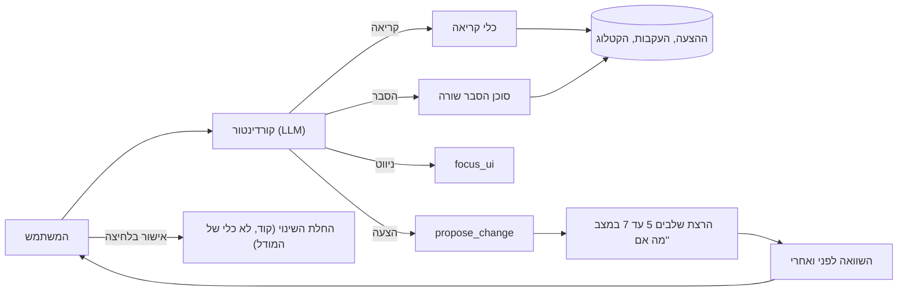

# שכבת הצ'אט

| | |
| --- | --- |
| **מוצר** | קונבורו, מערכת הצעות מחיר למפעלי לוחות חשמל |
| **רכיב** | שכבת פקודות בשפה חופשית מעל מסך הבדיקה |
| **גרסה** | 0.1 (טיוטה) |
| **תאריך** | 30.10.2026 |
| **תלוי ב-** | [00 ארכיטקטורה](00-architecture.md), [05 התאמה](05-catalog-matching.md), [06 בדיקה](06-validation.md), [07 תמחור](07-pricing.md) |

---

## 1. מטרה

שכבת הצ'אט מאפשרת לאומדן לעבוד על ההצעה במילים במקום בלחיצות:
- **לשאול:** "למה השורה הזו 3 קטבים?", "כמה מפסקי פחת יש בלוח 2?"
- **לשנות בבת אחת:** "תחליף את כל המא"זים לשניידר", "כל המא"זים בלוח הראשי 10kA"
- **לנווט:** "תראה לי את כל השורות האדומות בלוח 2"
- **להשוות:** "מה השתנה מהגרסה הקודמת?"

**מה הצ'אט לא:** הוא לא מחליף את מסך הבדיקה. המסך המפוצל, הצבעים והתיקון בלחיצה נשארים הדרך העיקרית לעבוד. הצ'אט הוא פאנל צד, לפעולות שבמסך היו דורשות הרבה לחיצות או חיפוש.

### עקרונות מנחים

1. **הצ'אט מציע, המשתמש מאשר.** כל שינוי מוצג כהצעה עם השוואה לפני ואחרי. למודל אין כלי שמחיל שינוי. רק לחיצה של המשתמש מחילה.
2. **הכלים הם קוד.** המודל בוחר כלי ופרמטרים. החישוב, הסינון וההתאמה לקטלוג קורים בקוד, באותם שלבים של הצינור.
3. **כל תשובה מבוססת על נתונים.** כל טענה על שורה מפנה לשורה. כל הסבר נשען על העקבות שהצינור כבר שמר. אם אין מידע, הצ'אט אומר שאין.
4. **המודל לא רואה סכומי כסף.** הוא מקבל הפניות לסכומים, והממשק מציג את המספרים. כך עלויות ורווח לא נשלחים למודל, והמודל גם לא מבצע חשבון על כסף (ראו 5.4).
5. **ההיקף הוא ההצעה הפתוחה.** הצ'אט לא משנה הגדרות של המפעל (מחירונים, חוקי רווח, העדפות). הוא יכול להפנות להגדרות עם טופס ממולא מראש.

---

## 2. תחום

### בתוך התחום
- שאלות על ההצעה הפתוחה: שורות, כמויות, תכונות, סטטוסים, סיכומים.
- הסבר שורה: מאיפה הגיע כל ערך, למה נבחר המק"ט, למה הצבע.
- שינויים מרובים כהצעה: החלפת מותג, מק"ט, תכונה, כמות, מחיקה, הוספה, מחיר ידני לשורות בהצעה הזו, הנחת לקוח.
- ניווט: סימון שורות ורכיבים במסך המפוצל.
- השוואה לגרסה קודמת של ההצעה, או להצעה אחרת של אותו מפעל.
- חיפוש בקטלוג.
- הרצה חוזרת של הבודק.
- "לזכור" בחירה: כתיבה לזיכרון ההתאמות, רק אם המשתמש בחר בזה במפורש.

### מחוץ לתחום
- שינוי מחירונים, חוקי רווח, העדפות מפעל, כללי פריטים נלווים וכללי בודק.
- שליחת הצעה ללקוח.
- פעולות על כמה הצעות בבת אחת ("עדכן את כל ההצעות הפתוחות").
- ייעוץ הנדסי או אישור תכנון. הצ'אט יכול להסביר מה המערכת מצאה, לא לאשר שהתכנון תקין.
- שיחה כללית שלא קשורה להצעה.

---

## 3. מונחים

| מונח | הגדרה |
| --- | --- |
| **קורדינטור** | מודל ה-LLM שמקבל את הודעת המשתמש ובוחר כלים |
| **כלי (Tool)** | פונקציה בקוד שהקורדינטור יכול לקרוא לה |
| **הצעת שינוי (Proposal)** | רשימת שינויים עם השוואה מלאה לפני ואחרי. לא מוחלת עד שהמשתמש מאשר |
| **הפניית סכום (Money ref)** | מזהה של סכום כסף, למשל `$T1`. המודל רואה את המזהה, הממשק מציג את המספר |
| **הפניית שורה (Line ref)** | מזהה שורה בתשובה, שהממשק מציג כתגית לחיצה |
| **הקשר הממשק (UI context)** | מה שהמשתמש רואה או בחר במסך כשכתב את ההודעה |
| **היקף זיכרון (Remember scope)** | האם שינוי חל רק על ההצעה הזו, או נשמר גם ללקוח או למפעל |

---

## 4. ארכיטקטורה



**הקורדינטור** הוא המקום היחיד במערכת שבו LLM מחליט על הזרימה, כי הבקשות פתוחות (ראו [00 §4.3](00-architecture.md)). כל השאר הוא קוד.

**סוכן הסבר השורה** הוא סאב-אייג'נט: הוא מקבל את העקבות של שורה אחת וחיתוך מהשרטוט, ולא את כל השיחה.

**החלת שינוי** קורית רק מלחיצה של המשתמש על כרטיס ההצעה. היא קוראת ל-API של ההצעה ישירות, ולא דרך המודל.

---

## 5. קלט

### 5.1 בקשה

```json
{
  "quote_id": "quo_2291",
  "quote_version": 1,
  "user_id": "usr_08",
  "message": "תחליף את כל המא\"זים בלוח הראשי לשניידר",
  "ui_context": {
    "panel_id": "pnl_01",
    "selected_line_ids": [],
    "active_filter": null
  },
  "conversation_id": "conv_551"
}
```

| שדה | תיאור |
| --- | --- |
| `quote_id`, `quote_version` | ההצעה הפתוחה והגרסה שהמשתמש רואה |
| `message` | ההודעה |
| `ui_context.panel_id` | הלוח שפתוח במסך. "הלוח הזה" מתפרש לפיו |
| `ui_context.selected_line_ids` | שורות שהמשתמש סימן. "השורות האלה" מתפרש לפיהן |
| `ui_context.active_filter` | הסינון הפעיל במסך, אם יש |
| `conversation_id` | השיחה הפעילה של ההצעה (5.2.1) |

### 5.2 מה הקורדינטור מקבל בכל תור

| רכיב | פירוט |
| --- | --- |
| הנחיות מערכת והגדרות הכלים | קבועים. נשמרים במטמון של ספק המודל |
| **תקציר ההצעה** | לוחות, מספר שורות לכל לוח ולכל צבע, משפחות ומותגים עיקריים. **בלי רשימת כל השורות ובלי סכומים** |
| הקשר הממשק | מ-5.1 |
| היסטוריית השיחה | לפי תקציב טוקנים, לא לפי מספר תורות (5.2.1) |
| הרשאות המשתמש | כדי שהמודל ידע אילו כלים זמינים לו |

### 5.2.1 ניהול שיחות והקשר

**ספק המודל לא שומר שיחות.** ה-API של Claude, גם דרך Bedrock, הוא stateless: כל קריאה שולחת את כל ההקשר מחדש. ההיסטוריה, החיתוך שלה והשמירה שלה הם באחריות שלנו, ב-Postgres.

**האמת נמצאת בהצעה, לא בשיחה.** כל שינוי שאושר נשמר בהצעה ובגרסה שלה, וכל "לזכור" נשמר בזיכרון ההתאמות ([05 §5.3](05-catalog-matching.md)). בכל תור הקורדינטור בונה את ההקשר מחדש מהמצב הנוכחי של ההצעה. לכן שיחה שנחתכה, או שיחה חדשה, לא מאבדות שום החלטה.

| נושא | החלטה |
| --- | --- |
| **שיחה חדשה** | כפתור "שיחה חדשה" בחלון הצ'אט. השיחה הקודמת נסגרת ונשארת לקריאה בלבד, כולל הצעות השינוי שאושרו בה. לכל הצעה יש שיחה פעילה אחת |
| **שיחה בין הצעות** | אין. כל שיחה שייכת להצעה אחת. שאלה על הצעה אחרת נפתחת מההצעה האחרת |
| **תקציב** | ההקשר של כל תור מוגבל ב-`chat_context_budget_tokens` (ברירת מחדל 30,000). התקציר וההנחיות קודמים. ההיסטוריה ממלאת את השאר, מהתור האחרון אחורה |
| **תוצאות כלים** | רק התוצאות של התור האחרון נשלחות במלואן. תוצאות ישנות מוחלפות בשורת סיכום ("query_lines: 12 שורות, מא"זים בלוח 2") |
| **דחיסה** | כשההיסטוריה חורגת מהתקציב, התורות הישנים מסוכמים בפסקה אחת על ידי מודל קטן (שלב `chat_compaction` ב-`config.py`), והסיכום נשמר עם השיחה. **אסור שסכומי כסף ייכנסו לסיכום**, כמו בכל מקום בצ'אט (5.4) |
| **מטמון** | ההנחיות והגדרות הכלים זהות בכל תור, ולכן נשמרות במטמון הפרומפט של הספק. לבדוק שהמטמון נתמך במודלים שנבחרו ב-Bedrock |
| **הצינור** | לא משתמש בשיחות בכלל. כל קריאה של שלב עומדת בפני עצמה: אריח, מקטעים, סכמה. גודל ההקשר נקבע בחיתוך לאריחים ([02 §2.6](02-extraction-tiling.md)), לא בהיסטוריה |

**למה לא כל השורות:** בהצעה יש 150 שורות ויותר. המודל מבקש את מה שהוא צריך דרך כלי הקריאה. כך ההקשר קטן, והתשובות מבוססות על שאילתה ולא על "זיכרון" של רשימה ארוכה.

### 5.3 הרשאות

**בגרסה 1.0 יש משתמש אחד עם כל ההרשאות** ([00 §14.1](00-architecture.md)), ולכן המודל מקבל את כל הכלים. הטבלה היא התכנון להמשך.

**הכלים שהמודל מקבל נקבעים לפי תפקיד המשתמש.** כלי שהמשתמש לא מורשה לו לא מופיע ברשימה בכלל, וגם שכבת הכלים בודקת את ההרשאה בכל קריאה.

| יכולת | נדרשת הרשאה |
| --- | --- |
| קריאה, הסבר, ניווט | צפייה בהצעה |
| הצעת שינוי | עריכת הצעה |
| הצגת עלויות ורווח (דרך הפניות) | צפייה בעלויות |
| מחיר ידני, הנחת לקוח | עריכת מחירים |
| "לזכור למפעל" | ניהול העדפות |

### 5.4 סכומי כסף: הפניות במקום מספרים

**כל כלי שמחזיר סכום כסף מחזיר הפניה, לא מספר.**

```json
{"panel_id": "pnl_02", "line_count": 23, "price_total": "$T1", "cost_total": "$T2"}
```

המודל כותב בתשובה: "סך הלוח: {{$T1}}". הממשק מחליף את ההפניה בסכום האמיתי מתוך תוצאת הכלי, שנשמרה בצד השרת.

| יתרון | למה |
| --- | --- |
| עלויות ורווח לא נשלחים לספק המודל | עיקרון 9 בארכיטקטורה ([00 §3](00-architecture.md)) |
| המודל לא עושה חשבון על כסף | כל סכום מחושב בקוד, בשלב 7. אין "המודל חיבר לא נכון" |
| הרשאות | הפניית עלות שהמשתמש לא מורשה לראות לא נוצרת בכלל |

**מספרים שאינם כסף** (כמויות, זרם, קטבים, מספר שורות) מוחזרים כרגיל.

**השוואה בין סכומים:** כשהמשתמש שואל "בכמה זה התייקר?", כלי בקוד מחשב את ההפרש ומחזיר הפניה להפרש. המודל לא מחסר.

---

## 6. כלים

### 6.1 רשימת הכלים

| כלי | סוג | מה הוא עושה |
| --- | --- | --- |
| `query_lines` | קריאה | מחפש שורות לפי סינון |
| `get_line_details` | קריאה | מחזיר את כל העקבות של שורה |
| `get_totals` | קריאה | סיכומים ללוח או להצעה (הפניות) |
| `explain_line` | קריאה, סאב-אייג'נט | עונה על "למה" לגבי שורה |
| `compare` | קריאה | השוואה לגרסה קודמת או להצעה אחרת |
| `search_catalog` | קריאה | חיפוש מק"טים לפי טקסט או תכונות |
| `propose_change` | הצעה | יוצר הצעת שינוי עם השוואה |
| `rerun_validation` | הצעה | מריץ שוב את הבודק ומחזיר ממצאים |
| `focus_ui` | ניווט | מסמן שורות, לוח או אזור בשרטוט |
| `open_settings` | ניווט | פותח מסך הגדרות עם טופס ממולא מראש |

**אין כלי `apply`.** החלת שינוי היא לחיצה של המשתמש, לא החלטה של המודל.

### 6.2 `query_lines`

**קלט**

| שדה | סוג | תיאור |
| --- | --- | --- |
| `panel_ids` | string[] | ריק = כל הלוחות |
| `families` | string[] | למשל `circuit_breaker`, `rcd` |
| `attributes` | object | למשל `{"current_a": 16, "poles": 3}` |
| `manufacturers` | string[] | |
| `statuses` | enum[] | `green`, `yellow`, `red` |
| `line_types` | enum[] | `component`, `derived`, `labor`, `manual`, `missing` |
| `has_issue` | bool | |
| `attribute_source` | enum | למשל `tenant_default`, כדי למצוא שורות שהושלמו מברירת מחדל |
| `limit` | int | ברירת מחדל 50 |

**פלט:** רשימת שורות עם `line_id`, תיאור, מק"ט, יצרן, כמות, תכונות, צבע, וסכומים כהפניות. וגם `total_count`, אם הוגבל.

### 6.3 `get_line_details`

**קלט:** `line_id`.

**פלט:** כל מה שהצינור שמר על השורה:
- התכונות, ולכל אחת: מקור (`drawing`, `cad_attrib`, `graphic`, `shared_label`, `notes`, `tenant_default`, `system_default`), הטקסט שממנו נקראה, וביטחון.
- המופעים והמיקום שלהם בשרטוט.
- החלטת ההתאמה: `method`, `brand_decision`, `substitution`, `reason`, החלופות ([05 §6](05-catalog-matching.md)).
- ממצאי הבודק ([06 §6](06-validation.md)).
- עקבת המחיר, עם סכומים כהפניות ([07 §6](07-pricing.md)).
- `status_reasons`: כל הסיבות לצבע.

### 6.4 `explain_line` (סאב-אייג'נט)

**מתי:** שאלות "למה" על שורה אחת, כשהתשובה לא מתקבלת ישירות מ-`get_line_details`. למשל: "למה 3 קטבים? אני לא רואה את זה בשרטוט".

**קלט לסוכן**

| רכיב | פירוט |
| --- | --- |
| השאלה | כפי שהמשתמש כתב |
| עקבות השורה | הפלט של `get_line_details` |
| חיתוך מהשרטוט | סביב המופעים של השורה, עם הסימנים מסומנים |
| המקטעים שצוטטו | הטקסט והמיקום |

**פלט**

```json
{
  "answer": "מספר הקטבים לא כתוב בטקסט ליד הרכיב. הוא נקרא מהסימון הגרפי: שלושה קווים אלכסוניים על קו ההזנה. בגלל זה הביטחון בתכונה נמוך יותר, והשורה צהובה",
  "cites": {"line_ids": ["ln_0001"], "instance_ids": ["ins_0017"], "span_ids": []},
  "focus": {"instance_ids": ["ins_0017"]},
  "confidence": 0.8,
  "trace_supported": true
}
```

**כללים:**
- **עונה רק מהעקבות ומהחיתוך.** אם העקבות לא מסבירות, הסוכן אומר שאין מספיק מידע ומציע לבדוק את הרכיב בשרטוט.
- **מבחין בין מה שנקרא לבין מה שהושלם.** תכונה עם `source` = `tenant_default` מוסברת כך: "לא כתוב בשרטוט. נלקח מברירת המחדל של המפעל".
- `focus` גורם לממשק לסמן את הרכיב בשרטוט כשהתשובה מוצגת.

### 6.5 `compare`

**קלט:** `target`: גרסה קודמת של אותה הצעה (`version`), או הצעה אחרת של אותו מפעל (`quote_id`).

**פלט:** שורות שנוספו, נמחקו או השתנו (מק"ט, כמות, תכונה, מחיר), עם הסיבה כשידועה (עדכון מחירון, שינוי ידני, שינוי בשרטוט). הפרשים בסכומים כהפניות.

**השוואה להצעה אחרת:** לפי חתימות הרכיבים ([05 §3](05-catalog-matching.md)), כי מזהי השורות שונים.

### 6.6 `search_catalog`

**קלט:** טקסט חופשי, או משפחה ותכונות, ואופציונלית יצרן.

**פלט:** עד 10 פריטים עם מק"ט, יצרן, סדרה, תיאור, תכונות ו-`has_cost_price`. **בלי מחיר.**

### 6.7 `propose_change`

**קלט**

```json
{
  "changes": [
    {
      "type": "replace_brand",
      "target": {"panel_ids": ["pnl_01"], "families": ["circuit_breaker"], "symbol_classes": ["mcb"]},
      "params": {"manufacturer": "Schneider Electric"}
    }
  ],
  "summary_he": "החלפת כל המא\"זים בלוח הראשי לשניידר"
}
```

**סוגי שינויים**

| `type` | פרמטרים | מה רץ מחדש | הערות |
| --- | --- | --- | --- |
| `replace_brand` | יצרן, ואופציונלית סדרה | שלב 5 עם עקיפת מותג, ואז 6 ו-7 | רכיב בלי התאמה במותג החדש נשאר עם המק"ט הקודם, ומסומן בהשוואה |
| `replace_sku` | מק"ט | 6, 7 | המק"ט חייב להיות קיים בקטלוג. **אם התכונות שלו לא תואמות לרכיב, ההצעה מסומנת באזהרה** |
| `set_attribute` | תכונה וערך | 5, 6, 7 | המקור של התכונה הופך ל-`user` |
| `set_quantity` | כמות | 6, 7 | |
| `delete_lines` | — | 6, 7 | שורה נגזרת שנמחקה לא חוזרת בחישוב מחדש ([07 §7.4](07-pricing.md)) |
| `add_line` | מק"ט, כמות, לוח | 6, 7 | `line_type` = `manual` |
| `set_line_price` | מחיר יחידה (מהמשתמש) | 7 | נשמר כ-`override` בשורה ([07 §6.2](07-pricing.md)). **רק להצעה הזו** |
| `set_line_margin` | אחוז, `markup` או `margin` | 7 | כנ"ל |
| `set_customer_discount` | אחוז | 7 | ברמת ההצעה |
| `restore_derived` | מזהה כלל | 7 | מחזיר שורה נגזרת שנמחקה |

**`target`** הוא סינון באותו מבנה של `query_lines`, או רשימת `line_ids`. הקוד מפענח אותו לרשימת שורות. **המודל לא צריך לפרט שורות אחת אחת**, וזה מונע פספוס של שורה ברשימה ארוכה.

**כש-`set_line_price` או `set_line_margin` מגיעים מהמשתמש בצ'אט:** הערך נלקח מהודעת המשתמש ("תעשה 18%"). המודל לא ממציא אחוזים או מחירים.

**פלט:** הצעת שינוי (סעיף 7).

### 6.8 `focus_ui`

**קלט:** `line_ids`, או `panel_id`, או `instance_ids`, או סינון. **פלט:** פעולת ממשק. השורות מסומנות בטבלה, והרכיבים מסומנים בשרטוט.

### 6.9 `open_settings`

**קלט:** סוג ההגדרה (`margin_rule`, `brand_preference`, `attribute_default`, `derived_rule`, `validator_rule`) וערכים מוצעים.

**פלט:** כפתור בתשובה שפותח את מסך ההגדרות עם טופס ממולא. **השמירה במסך ההגדרות**, עם ההרשאות והיומן הרגילים שלו.

**דוגמה:** המשתמש כותב "אצלנו מא"זים תמיד 10kA". הצ'אט לא משנה את ברירת המחדל. הוא מציע: שינוי של ההצעה הזו (`set_attribute`), וכפתור לעדכון ברירת המחדל של המפעל.

---

## 7. הצעת שינוי

### 7.1 מבנה

```json
{
  "proposal_id": "prp_0091",
  "quote_id": "quo_2291",
  "base_version": 1,
  "base_revision": 37,
  "created_by": "chat",
  "summary_he": "החלפת כל המא\"זים בלוח הראשי לשניידר",
  "changes": [ "...כפי שנשלחו ל-propose_change..." ],
  "affected_line_count": 12,
  "diff": {
    "lines_changed": [
      {
        "line_id": "ln_0003",
        "before": {"sku": "2CDS253001R0164", "manufacturer": "ABB", "qty": 4, "status": "green", "line_total": "$A1"},
        "after":  {"sku": "A9F74316", "manufacturer": "Schneider Electric", "qty": 4, "status": "green", "line_total": "$A2"},
        "note": null
      },
      {
        "line_id": "ln_0007",
        "before": {"sku": "2CDS251001R0634", "manufacturer": "ABB", "status": "green"},
        "after":  {"sku": "2CDS251001R0634", "manufacturer": "ABB", "status": "yellow"},
        "note": "אין בקטלוג מא\"ז 1P 63A D של שניידר. המק\"ט הקודם נשאר"
      }
    ],
    "lines_added": [],
    "lines_removed": [],
    "derived_changes": [
      {"line_id": "ln_0019", "description": "ארון", "before_qty": 1, "after_qty": 1, "note": "ללא שינוי"}
    ],
    "totals_before": {"net_total": "$B1", "margin_pct": "$B2"},
    "totals_after":  {"net_total": "$B3", "margin_pct": "$B4"},
    "new_issues": [],
    "resolved_issues": []
  },
  "remember_options": ["quote_only", "customer", "tenant"],
  "remember_default": "quote_only",
  "warnings": ["partial_brand_coverage"],
  "status": "pending",
  "expires_when": "quote_revision_changes"
}
```

### 7.2 איך נוצרת ההשוואה

1. העתק של ההצעה במצבה הנוכחי.
2. החלת השינויים על ההעתק.
3. הרצת השלבים שצריך (טבלה ב-6.7) על השורות שהושפעו, **באותו קוד של הצינור**.
4. חישוב מחדש של פריטים נלווים וסיכומים.
5. השוואה בין ההעתק למקור.

**ההצעה מראה את כל ההשפעות**, כולל אלה שהמשתמש לא ביקש: ארון שגדל, ממצא חדש של הבודק, שורה שלא הצליחה להתחלף.

### 7.3 כרטיס ההצעה בממשק

| אזור | תוכן |
| --- | --- |
| כותרת | `summary_he` ומספר השורות שמושפעות |
| השוואה | טבלה של שורות לפני ואחרי. השורות מסומנות גם במסך הראשי |
| סיכומים | לפני ואחרי, לפי הרשאה |
| אזהרות | שורות שלא השתנו כמו שביקשו, ממצאים חדשים |
| זיכרון | "רק בהצעה הזו" (ברירת מחדל) / "לזכור ללקוח הזה" / "לזכור למפעל" |
| פעולות | **אשר**, **בטל**, ו"אשר חלקית" (בחירת שורות) |

### 7.4 היקף זיכרון

| בחירה | מה נשמר | איפה |
| --- | --- | --- |
| `quote_only` | רק השינוי בהצעה | — |
| `customer` | רשומת זיכרון התאמות עם `customer_id` | [05 §11](05-catalog-matching.md) |
| `tenant` | רשומת זיכרון התאמות למפעל | [05 §11](05-catalog-matching.md). דורש הרשאת ניהול העדפות |

**ברירת המחדל היא `quote_only`.** "תחליף לשניידר" בהצעה אחת לא אומר שהמפעל רוצה שניידר בכל ההצעות הבאות.

`set_line_price`, `set_line_margin` ו-`set_customer_discount` הם תמיד `quote_only`. שינוי קבוע במחירים עובר דרך `open_settings`.

### 7.5 החלה, תפוגה וביטול

| מצב | התנהגות |
| --- | --- |
| המשתמש אישר, וההצעה לא השתנתה מאז שההצעה נוצרה | השינוי מוחל. נרשם ביומן השינויים של ההצעה |
| ההצעה השתנתה מאז (`base_revision` שונה) | ההצעה פגה. הממשק מציע ליצור אותה מחדש על המצב הנוכחי |
| ההצעה במצב `sent` | האישור יוצר גרסה חדשה של ההצעה ([07 §7.7](07-pricing.md)) |
| ביטול | כל שינוי שהוחל ניתן לביטול מיומן השינויים, אם השורות לא השתנו מאז. אחרת, הביטול מוצג כהצעה חדשה עם השוואה |

---

## 8. תשובת הצ'אט

### 8.1 מבנה

```json
{
  "conversation_id": "conv_551",
  "turn_id": "turn_0012",
  "blocks": [
    {"type": "text", "content": "בלוח הראשי יש 12 שורות מא\"ז, 11 מהן של ABB. הכנתי הצעה להחליף את כולן לשניידר. שורה אחת ({{line:ln_0007}}) נשארת ABB, כי אין לשניידר מא\"ז 1P 63A עקומה D בקטלוג."},
    {"type": "proposal", "proposal_id": "prp_0091"},
    {"type": "ui_action", "action": "focus", "line_ids": ["ln_0003", "ln_0004", "ln_0007"]}
  ],
  "tool_calls": [
    {"tool": "query_lines", "args": {"panel_ids": ["pnl_01"], "families": ["circuit_breaker"]}},
    {"tool": "propose_change", "args": {"...": "..."}}
  ],
  "money_refs": {"$A1": "...", "$A2": "..."},
  "trace_id": "trc_..."
}
```

**סוגי בלוקים**

| `type` | תוכן |
| --- | --- |
| `text` | טקסט עם הפניות: `{{line:...}}`, `{{$T1}}`, `{{instance:...}}`. הממשק מציג אותן כתגיות לחיצות או כסכומים |
| `proposal` | כרטיס הצעת שינוי |
| `clarification` | שאלת הבהרה עם אפשרויות לבחירה בלחיצה (סעיף 9) |
| `ui_action` | סימון שורות או רכיבים במסך |
| `settings_link` | כפתור למסך הגדרות עם טופס ממולא |

`money_refs` נשמר בצד השרת ומשמש את הממשק בלבד. **הוא לא נשלח למודל.**

### 8.2 אימות התשובה (קוד)

| בדיקה | כשל | פעולה |
| --- | --- | --- |
| כל `{{line:...}}` קיים בהצעה | לא | ההפניה מוסרת מהטקסט, ונרשם `invalid_ref` |
| כל `{{$...}}` נוצר בתור הזה או בתור קודם בשיחה | לא | ההפניה מוחלפת ב"—" ונרשם `invalid_ref` |
| **מספר שנראה כמו סכום כסף כתוב בטקסט** (₪, ש"ח, או מספר עם נקודה עשרונית בהקשר של מחיר) | כן | הטקסט נשלח שוב למודל עם הוראה להשתמש בהפניות. אם שוב נכשל, המספר מוסר |
| `ui_action` מפנה לשורות קיימות | לא | הפעולה מושמטת |

---

## 9. עמימות ובקשות רחבות

| מצב | התנהגות |
| --- | --- |
| הבקשה לא מציינת על מה ("תחליף את המא"זים") וההקשר לא מכריע | שאלת הבהרה עם אפשרויות: "בלוח הראשי (12 שורות)" / "בכל הלוחות (31 שורות)" |
| "השורות האלה" בלי שורות מסומנות | שאלת הבהרה |
| הבקשה משפיעה על יותר מ-30 שורות | נוצרת הצעה, אבל הכרטיס מציג אזהרה בולטת עם מספר השורות |
| מחיקה של יותר מ-5 שורות | נוצרת הצעה. הכפתור הוא "מחק X שורות", לא "אשר" |
| הבקשה סותרת את הקטלוג ("תחליף ל-16A של שניידר" כשאין) | תשובה עם מה שנמצא בקטלוג, והצעת חלופות מ-`search_catalog` |
| בקשה מחוץ לתחום ("תעדכן את המחירון") | הסבר קצר וכפתור `open_settings` |
| שאלה על תקינות התכנון ("זה תקין לפי התקן?") | הצ'אט מציג את ממצאי הבודק, ואומר במפורש שזו לא בדיקה הנדסית ([06 §1](06-validation.md)) |

**שאלת הבהרה אחת לכל היותר לפני פעולה.** אם עדיין לא ברור, הצ'אט בוחר את הפרשנות הצרה יותר (הלוח הפתוח, השורות המסומנות), אומר במפורש מה הוא בחר, ויוצר הצעה.

---

## 10. אבטחה ופרטיות

| נושא | כלל |
| --- | --- |
| **סכומי כסף** | המודל לא רואה סכומים, רק הפניות (5.4) |
| **הרשאות** | כלים לפי תפקיד, ובדיקה בכל קריאה בשכבת הכלים (5.3) |
| **בידוד מפעלים** | כל הכלים פועלים רק על נתוני המפעל של המשתמש. `compare` להצעה אחרת רק באותו מפעל |
| **הזרקת הוראות מהשרטוט** | טקסט מהשרטוט (מקטעים, הערות, כתב כמויות) מגיע לצ'אט דרך הכלים. הוא **נתון, לא הוראה**. ההנחיות למודל אומרות זאת במפורש, והטקסט מסומן בתוצאות הכלים כ"תוכן מהשרטוט". הנזק האפשרי מוגבל ממילא: למודל אין כלי שמחיל שינוי, ואין לו גישה מחוץ להצעה |
| **יומן** | כל תור נשמר: ההודעה, הכלים שנקראו עם הפרמטרים, ההצעות, ומה המשתמש אישר |
| **שמירת שיחות** | השיחה שייכת להצעה ונשמרת איתה |

---

## 11. שגיאות

| קוד | מתי | הודעה למשתמש (טיוטה) |
| --- | --- | --- |
| `proposal_expired` | ההצעה השתנתה מאז שנוצרה הצעת השינוי | "ההצעה עודכנה מאז. ליצור את השינוי מחדש?" |
| `tool_failed` | כלי נכשל | "לא הצלחתי לבצע את זה. אפשר לנסות שוב או לבצע במסך" |
| `permission_denied` | ניסיון לפעולה בלי הרשאה (לא אמור לקרות, כי הכלי לא זמין) | "אין לך הרשאה לפעולה הזו" |
| `out_of_scope` | בקשה מחוץ לתחום | הסבר + `open_settings` כשרלוונטי |
| `no_catalog_match` | אין מוצר שמתאים לבקשה | "לא מצאתי בקטלוג מא"ז 3P 16A של שניידר. הנה מה שיש:" |
| `partial_brand_coverage` | `replace_brand` לא הצליח בחלק מהשורות | מוצג בכרטיס ההצעה |
| `invalid_ref` | המודל הפנה לשורה או לסכום שלא קיימים | פנימי. נרשם למעקב איכות |

---

## 12. ביצועים (יעדים ראשוניים)

| מדד | יעד |
| --- | --- |
| זמן עד תחילת תשובה | עד 2 שניות |
| שאלת קריאה (p95) | עד 6 שניות |
| הצעת שינוי, כולל הרצת שלבים 5 עד 7 על השורות שהושפעו (p95) | עד 8 שניות |
| `explain_line` (p95) | עד 12 שניות |
| החלת הצעה אחרי אישור | עד שנייה |

---

## 13. מדדים וקריטריוני קבלה

### 13.1 סט בדיקה לצ'אט

כמו לצינור, גם לצ'אט צריך סט בדיקה: **כ-200 בקשות אופייניות בעברית**, על הצעות מסט הבדיקה הראשי. לכל בקשה מוגדרים הכלים והפרמטרים הצפויים, או התשובה הצפויה. הסט כולל:
- שאלות ("כמה מפסקי פחת יש?").
- שינויים, כולל ניסוחים שונים לאותו דבר ("תחליף לשניידר", "תעשה הכל שניידר", "שניידר במקום ABB").
- בקשות עמומות, שבהן התשובה הנכונה היא שאלת הבהרה.
- בקשות מחוץ לתחום.
- ניסיונות להשיג עלויות בלי הרשאה, או לגרום למודל לכתוב סכומים.
- טקסט בשרטוט שמנסה לתת הוראות.

### 13.2 יעדים

| מדד | יעד ראשוני |
| --- | --- |
| **הבנה נכונה:** הכלי והפרמטרים הנכונים | ≥ 95% |
| שאלת הבהרה כשצריך, ורק כשצריך | ≥ 90% |
| **סכומי כסף שהגיעו למודל** (בדיקה אוטומטית על כל ההקשרים שנשלחו) | **0** |
| **טענות על ההצעה שלא נתמכות בתוצאות הכלים** | **0** בסט הבדיקה |
| דליפת עלויות למשתמש בלי הרשאה | 0 |
| ביצוע הוראה שהגיעה מטקסט בשרטוט | 0 |

### 13.3 בייצור

| מדד | למה |
| --- | --- |
| אחוז הצעות השינוי שאושרו | המדד העיקרי. יעד ראשוני: ≥ 70% |
| אחוז השינויים שבוטלו אחרי אישור | שינוי שאושר ובוטל = הצעה מבלבלת. יעד: ≤ 10% |
| אחוז הבקשות שהסתיימו ב-`out_of_scope` | אם גבוה, אולי חסרה יכולת |
| הבקשות הנפוצות | בקשה שחוזרת הרבה היא מועמדת לכפתור במסך |

---

## 14. לולאת הלמידה

| מה קורה | מה נשמר | השפעה |
| --- | --- | --- |
| הצעה אושרה עם "לזכור" | רשומת זיכרון התאמות | השרטוט הבא ([05 §11](05-catalog-matching.md)) |
| הצעה נדחתה | הבקשה, הכלים וההצעה | נבדק ידנית. אם זו טעות הבנה, הבקשה נכנסת לסט הבדיקה |
| בקשה שלא הובנה, או שהמשתמש ניסח מחדש מיד | הבקשה וההקשר | מועמדת לסט הבדיקה |
| `open_settings` שהוביל לשמירה | — | מראה אילו הגדרות משתמשים רוצים לשנות מתוך העבודה |

**הצ'אט לא משנה את ההנחיות שלו לבד.** שינוי בהנחיות או בתיאורי הכלים עובר דרך סט הבדיקה, כמו כל שינוי במודל ([00 §7.2](00-architecture.md)).

---

## 15. נקודות פתוחות

1. **"אשר חלקית":** האם הממשק צריך לאפשר אישור של חלק מהשורות בהצעה? מוסיף גמישות, אבל מסבך את ההשוואה (סיכומים, פריטים נלווים).
2. **צ'אט בזמן שהצינור רץ:** האם לאפשר שאלות לפני שההצעה מוכנה? ("באיזה שלב זה?", "כמה לוחות יש?"). ההמלצה: לא בגרסה 1.
3. **הקלטה קולית:** אומדנים עובדים לפעמים מול שרטוט מודפס. האם להוסיף קלט קולי? לא בגרסה 1.
4. **שינוי הגדרות מהצ'אט עם אישור:** בגרסה עתידית, האם `open_settings` יכול להפוך להצעת שינוי להגדרות, עם אישור של מנהל? דורש מנגנון אישורים.
5. **שפה:** משתמשים יכתבו בעברית עם מונחים באנגלית ("C16", "RCD", "MCB"). לוודא שסט הבדיקה מכסה את זה.
6. **המודל:** קורדינטור במודל בינוני, וסוכן ההסבר במודל עם ראייה. להשוות על סט הבדיקה של הצ'אט.
